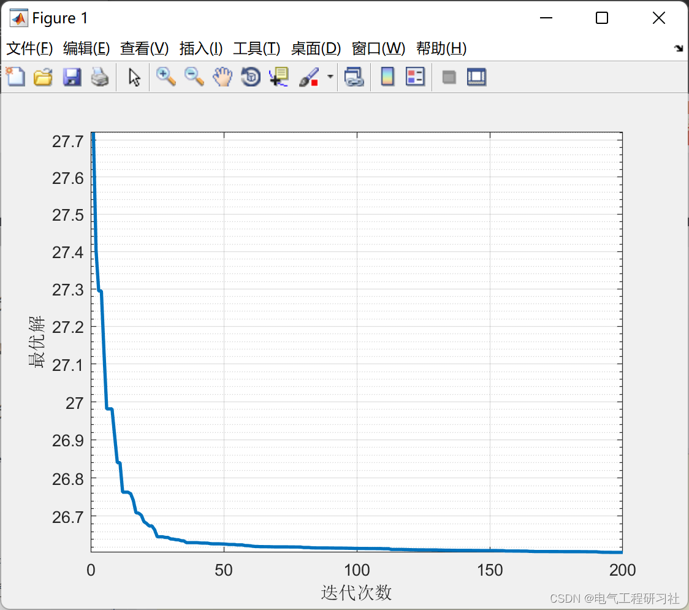

# Optimal Power Loss Reduction Based on Improved Genetic Algorithm (Matlab Code Implementation)

1. Overview
2. Optimal Power Flow Problem
3. Mathematical Model
4. MATLAB Code Implementation + Article Explanation
5. Conclusion
1. Overview
This paper addresses the optimal power flow problem for n-bus systems using an improved genetic algorithm. The model focuses solely on continuous control variables, namely the unit active power output and the magnitude of the generator bus voltage. Many functional operational constraints, such as relaxation of bus active power limits, load bus voltage magnitude limits, and generator reactive power constraints, are included in the GA fitness function as penalties. Advanced and problem-specific operators have been introduced to enhance the efficiency and accuracy of the algorithm.
2. The Optimal Power Flow (OPF) problem has been a subject of in-depth research since Carpentier introduced it as a network-constrained economic dispatch and Dommel and Tinney defined it as the Optimal Power Flow (OPF). OPF optimizes the objective function of power system operation, such as the operational cost of thermal resources, while satisfying a set of system operational constraints, including those imposed by the power grid. OPF has been widely applied in the operation and planning of power systems. After the restructuring of the electric sector, OPF has been used to evaluate the spatial variation of electricity prices and served as a tool for congestion management and pricing. In its most general formulation, OPF is a nonlinear, non-convex, large-scale, static optimization problem with continuous and discrete control variables. Even without non-convex unit operating cost functions, unit prohibited operating areas, and discrete control variables, the OPF problem is non-convex due to the presence of nonlinear (AC) power flow equations. The existence of discrete control variables, such as switchable shunt devices, transformer tap positions, and phase shifters, further complicates the solution to the problem. For this reason, we limit our solutions to discrete variables. Mathematical programming methods, such as Nonlinear Programming (NLP), Quadratic Programming (QP), and Linear Programming (LP), have been used to solve OPF problems. Every day, OPF programs based on mathematical programming methods are used to solve very large OPF problems. However, they cannot guarantee convergence to the global optimal value of the general non-convex OPF problem, despite some empirical evidence about the uniqueness of OPF solutions within the interested domain. Handling non-convex OPF objective functions and unit prohibited operating areas also pose challenges for mathematical programming OPF methods.
3. Mathematical Model See Section 4 below.
Algorithmic Innovations:
S.selection_type=input('Genetic Algorithm selection method: 1. Roulette Wheel Selection, 2. Competitive Selection, 3. Random Selection, 4. Randomly Generalized Sampling?');
Then, in the fourth section, compare different strategies.
4. MATLAB code implementation + detailed explanation of the article. This article only showcases a part of the code, and the full code can be found in:
Editor
Here is only one strategy, the combination of roulette and arithmetic crossover, other strategies are not shown.
Editor
5 Conclusions The GA solution for OPF problems has been proposed and applied to medium-sized power systems. The main advantages of the GA solution for OPF problems are its modeling flexibility: non-convex unit cost functions, prohibited unit operation regions, discrete control variables, and complex nonlinear constraints can be easily modeled. Another advantage is that it can be easily coded to work on parallel computers. The main disadvantage of GAs is that they are random algorithms, and the solutions provided by them for the OPF problem cannot guarantee optimality. Another drawback is that the execution time and the quality of the solutions provided increase with the length of the chromosome, i.e., the size of the OPF problem. The applicability of the GA solution for large-scale OPF problems with thousands of nodes still needs to be demonstrated using the power of parallel computers.
​  

## Images

<!-- PAYMENT_BLOCK -->

## Get this dataset

- Payment link (Stripe): [Buy now](https://buy.stripe.com/3cs8yP7sY87d0vu9AB)
- Payment QR code: 

<!-- /PAYMENT_BLOCK -->
